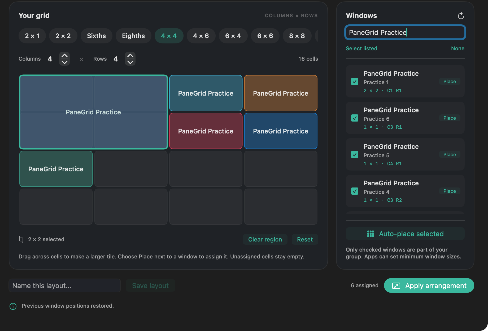
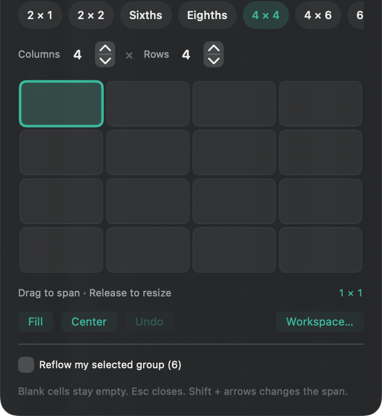
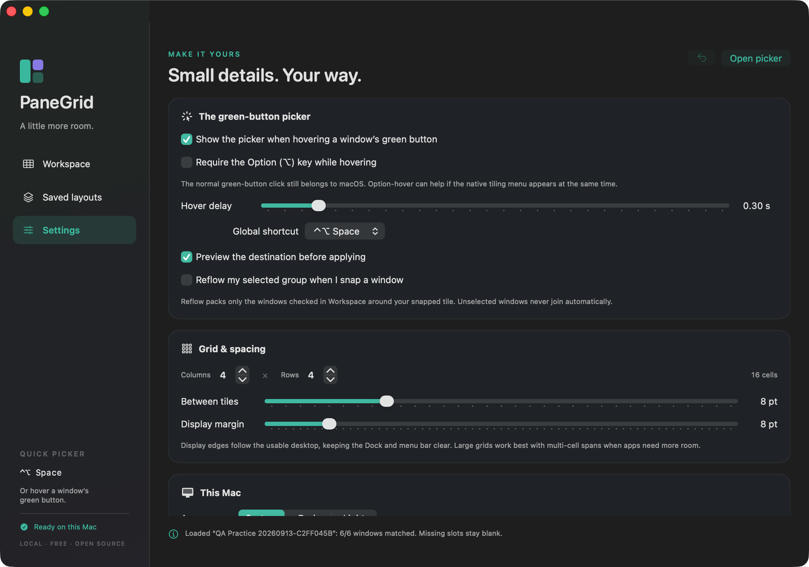

# PaneGrid

**An original, free, open-source window workspace for macOS.**

Draw a tile. Give it a window. Leave the rest open.

PaneGrid is a native SwiftUI/AppKit menu-bar utility for arranging your own desktop. It runs locally, without accounts, network services, analytics, subscriptions, or third-party package dependencies.



*Historical 1.0 native-window capture; current versions use full-card selection, dimension-labelled presets, and no Place button. Cropped to omit display-identifying information.*

## What it does

- **A picker beside the green button.** Hover or hold the actual macOS zoom button for about half a second, or press **Control–Option–Space**. Ordinary short clicks keep their normal fullscreen behavior.
- **Any grid from 1 × 1 to 24 × 24.** Presets are labelled consistently: **2 × 1, 2 × 2, 3 × 1, 3 × 2, 3 × 3, 4 × 2, 4 × 3, 4 × 4**, and larger. Dimensions are always **columns × rows**, not unexplained fractions. Presets wrap into visible rows instead of hiding in a horizontal scroller.
- **Multi-cell tiles.** Drag across adjacent cells to make any rectangular span. Release in the quick picker to resize that window.
- **Full-card selection.** Click anywhere on a window card to select or deselect it—there is no separate **Place** button. Choose a grid and **Apply arrangement** to tile the selected windows together. With exactly one window selected, drag a grid region to assign its custom span before applying.
- **Equal-cell auto-placement.** Fill unused cells with only the windows you checked. Existing assigned spans are respected; unused cells remain empty.
- **One-click app-wide tiling.** Enable **Tile all windows of this app** in the picker, then choose a preset to tile every eligible window in that exact app process. No manual group selection is needed. A drawn span gives them all that size.
- **Exact preset commands.** Switching from 3 × 2 to 4 × 2 keeps the 4 × 2 request. Movement and resizing settle separately against actual screen geometry; a logical Accessibility destination alone is not treated as a completed animation. If an app refuses a size, the picker explains the failure and leaves your chosen grid selected.
- **Optional fitting suggestions.** **Suggest a fitting grid if needed** offers an alternative after a measured size response, but never applies a replacement automatically. Choose **Try … instead** explicitly if you want it. The old `autoFitAppWindows` setting is preserved and now controls suggestions only.
- **Optional selected-group reflow.** A snapped window keeps its chosen span; your checked group is packed into the remaining cells. No unselected windows are added.
- **Saved layouts.** Name arrangements, load them into the editor, and export/import validated JSON. Missing and ambiguously titled windows remain blank instead of being guessed or launched.
- **Multiple displays.** Choose a destination display, including displays above or to the left of the primary screen. The usable desktop keeps the menu bar and Dock clear.
- **Undo and fit checks.** Up to 20 successful arrangements can be undone. Actual window frames are checked. A failed batch attempts to restore its previous positions and reports any restoration failures.
- **Bounded recovery.** Workspace has a **Cancel** button while arranging. Cancellation stops new moves, lets in-flight work drain, and restores changed windows before enabling another command. Failed operations do not continuously retry untouched windows.
- **Your preferences.** Grid dimensions, gaps, margins, hover delay, Option-only hover, previews, reflow, shortcut alternatives, app exclusions, appearance, pause, and optional launch at login.
- **Practice safely.** A bundled practice app opens six ordinary windows so you can learn without rearranging your work.

## Requirements

- macOS **14 Sonoma or newer**.
- For building: Xcode/Command Line Tools with **Swift 6.0+**.
- Accessibility permission for the installed PaneGrid app. **No Screen Recording or Input Monitoring permission is required for window management.**

The workspace editor is designed for at least 1050 × 740 points of desktop space. The small picker can be used without leaving the full editor open.

## Build and install

From the repository root:

```sh
swift test
/bin/zsh scripts/build-app.sh
/bin/zsh scripts/install-app.sh
```

This creates `build/PaneGrid.app`, installs it in the shared `/Applications` folder, and opens it. Each macOS user grants their own permission and has separate settings. If that folder is not writable, the installer stops rather than asking for an administrator password in a script; an administrator can copy the app with Finder.

In VS Code, **Run Build Task → PaneGrid: Build app** builds the app. No editor extensions are necessary.

### Local signing and updates

The build script defaults to **ad-hoc local signing**. If you already have a signing identity, you can keep a stable identity across rebuilds:

```sh
PANEGRID_SIGN_IDENTITY="Apple Development" /bin/zsh scripts/build-app.sh
/bin/zsh scripts/install-app.sh
```

The variable is optional; no `.env`, API keys, or online account is needed to build. Do not commit certificates or private keys. Ad-hoc rebuilds may need Accessibility approval again. When upgrading, the installer asks the existing app to quit, verifies the staged bundle, and refuses to replace a still-running instance. It retains the previous bundle in its temporary staging directory for recovery.

**Local signing is not notarization.** A downloadable binary for other Macs requires your own Developer ID signing/notarization workflow. Publishing the source does not require that. Do not instruct people to disable Gatekeeper, SIP, or macOS privacy protections.

## First use

1. Open **PaneGrid** from Applications.
2. Choose **Enable window control**. In **System Settings → Privacy & Security → Accessibility**, enable **PaneGrid**. Authenticate directly in macOS if asked. If it is missing from the list, use **+** to add `/Applications/PaneGrid.app`.
3. Return to PaneGrid. Permission is detected automatically; no restart should be needed.
4. Open **practice windows** from the menu bar or Settings if you want a harmless first try.
5. Hover or hold a green window button, or focus a normal window and press **⌃⌥ Space**.
6. Pick a grid and drag a tile. A destination outline previews the position; release to resize.

For several windows, open **Workspace**, click the cards you want, choose a grid, and select **Apply arrangement**. Auto-placement happens as part of Apply; **Auto-place selected** is optional if you want to preview it first. With one window selected, dragging on the grid assigns its custom span. Nothing moves until Apply. A 6 × 6 grid does not require 36 windows: one window can occupy several cells and everything else can stay empty.

To tile one entire app without checking windows individually, open that app's picker, enable **Tile all windows of this app**, and click **3 × 2**, **4 × 2**, **3 × 3**, or another preset. For custom row/column values, choose **Tile app windows**. Only that app's eligible windows are moved. Unused portions stay empty. When an app-wide request is already running, commands are serialized and only the newest pending request is kept; an older completion cannot restore an earlier preset on top of it.

Press-and-hold uses a mouse event tap after the green button has been verified. A quick click is replayed normally; unrelated clicks are not intercepted. Holding works even if ordinary hover is disabled. If the event tap cannot be enabled, PaneGrid reports that and retains the hover/shortcut entry points.

### Keyboard controls

| Control | Action |
| --- | --- |
| ⌃⌥ Space | Open the quick picker for the last external focused window |
| ⌃⇧ Space | Alternative shortcut, selectable in Settings |
| Arrow keys (grid focused) | Move the selected region |
| Shift + arrows | Grow/shrink its span |
| Return (quick-picker grid focused) | Apply the region |
| Escape | Close the picker |

Close the editor window to keep PaneGrid in the menu bar. Use **Quit PaneGrid** to stop window management completely. Launch at login is opt-in.

## Important macOS limits

- Public APIs do **not** let third-party apps insert items into the system's green-button menu. PaneGrid provides a separate nearby panel; it does not patch macOS or globally disable native tiling. If the native menu gets in the way, use the shortcut or enable **Require Option while hovering**.
- Apps control their minimum/maximum window sizes. A tiny single cell in a dense grid may not fit an editor or browser. Select a larger span; PaneGrid does not bypass the app's limits.
- Standard, resizable Accessibility windows are supported. Fullscreen, minimized, hidden-app, dialog, and non-resizable windows are excluded. Apps with incomplete Accessibility support may not expose a zoom button; try the shortcut, and expect a clear failure if sizing is unsupported.
- Window lists are app-provided and can include windows on other Spaces. PaneGrid does not switch Spaces or promise that all applications expose inactive-Space windows. It moves only explicitly assigned/selected windows.
- Saved layouts use an exact app identifier and unique window title, not a persistent document ID. Renamed, missing, or duplicate-title windows must be assigned again. Duplicate titles are deliberately omitted when saving; empty regions are preserved.
- Resizing several apps is sequential, not an OS-level atomic transaction. Rollback is best effort: if an app closes or stops responding, restoration can also fail, and PaneGrid reports that rather than claiming success.

## Privacy and local data

Settings and saved layouts live in:

`~/Library/Application Support/PaneGrid/configuration.json`

Writes are atomic, the directory is private to your account, and malformed/unsupported files are preserved before falling back to defaults. Exported layouts contain **application identifiers and window titles**: review them before publishing or sharing. Window contents, keystrokes, and screenshots are not collected or transmitted. See [PRIVACY.md](PRIVACY.md).

## Verification

```sh
swift test
.build/debug/PaneGrid --verify-interface /tmp/PaneGrid-interface.json
/bin/zsh scripts/verify-native.sh
/Applications/PaneGrid.app/Contents/MacOS/PaneGrid --verify-presets /tmp/PaneGrid-presets.json
```

- Core tests cover every 1–24 dimension pair, fractional geometry, spans, monitor transforms, invalid input, packing, and serialization.
- The interface probe uses actual AppKit windows, light/dark themes, large grids, and minimum sizing. It also reinstates the original intrinsic-size bug on an isolated test window to prove the regression check is meaningful. Its settings are ephemeral and it never accesses other apps.
- Native verification runs the installed app against its bundled practice process only. It checks sixths/eighths/dense grids, unselected-window isolation, spans, reflow, undo, rollback after minimum-size refusal, and the real green-button hit-test. **Exit 77 means permission/setup is blocked, not that tests passed.** It restores practice-window frames afterward.
- Preset verification runs 3 × 2 → 4 × 2 on the **same** six windows without resetting between commands. It includes delayed/coalesced and independently animated axes, Workspace → picker → Workspace transitions, cancellation, post-cancellation commands, and undo. It creates and closes only its own practice instances.

Build outputs, test artifacts, and local settings are ignored by Git. Review [docs/QA.md](docs/QA.md) for the actual verification status and the manual UI checklist.

## Screenshots

Actual macOS application captures, using only the bundled practice windows:

| Quick-picker controls | Settings |
| --- | --- |
|  |  |

The picker image omits its header/display selector for privacy. See [the QA report](docs/QA.md#native-screenshots) for capture provenance and the drag-selection screenshot.

## Publish and contribute

This repository contains the original source, build/install scripts, a macOS CI workflow, and an MIT license. You can publish it to your own GitHub repository. No remote repository or public release is created by the installer.

Use the normal GitHub “new repository” flow, then add that remote to this local repository. Review the diff before publishing: do not add `build/`, `.build/`, signing files, personal layout exports, or screenshots containing your own window titles. See [CONTRIBUTING.md](CONTRIBUTING.md).

## Uninstall

Disable **Launch PaneGrid at login** if enabled, choose **Quit PaneGrid**, and move `/Applications/PaneGrid.app` to Trash. You may remove its Accessibility entry in System Settings. Keep the Application Support directory to preserve layouts, or remove that exact directory to reset all preferences. The app does not install privileged helpers or system services.

## License

[MIT](LICENSE). Free to use, modify, and publish.
